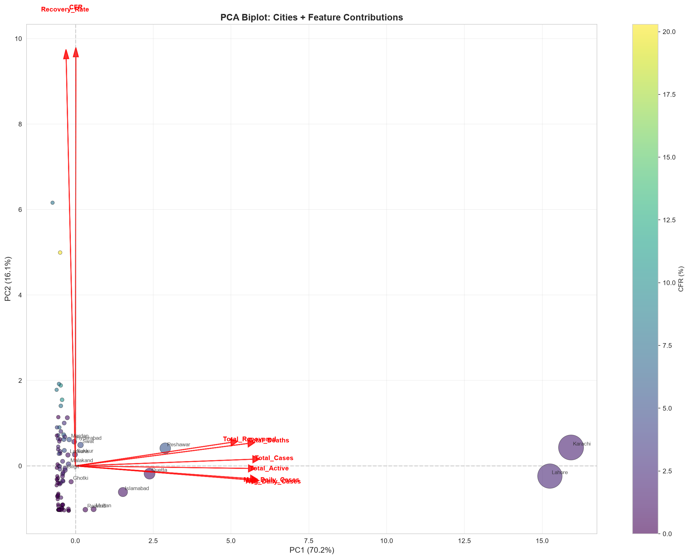
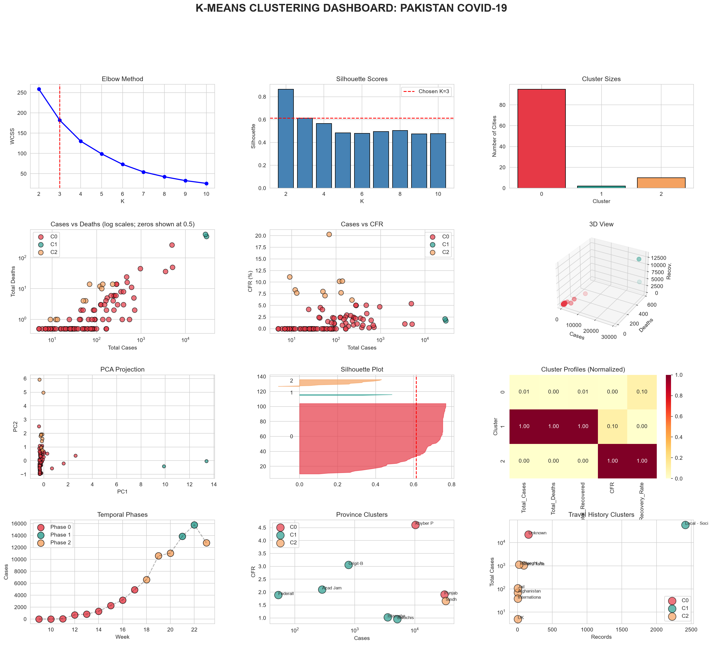
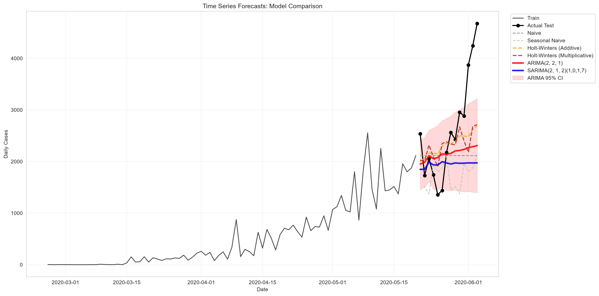
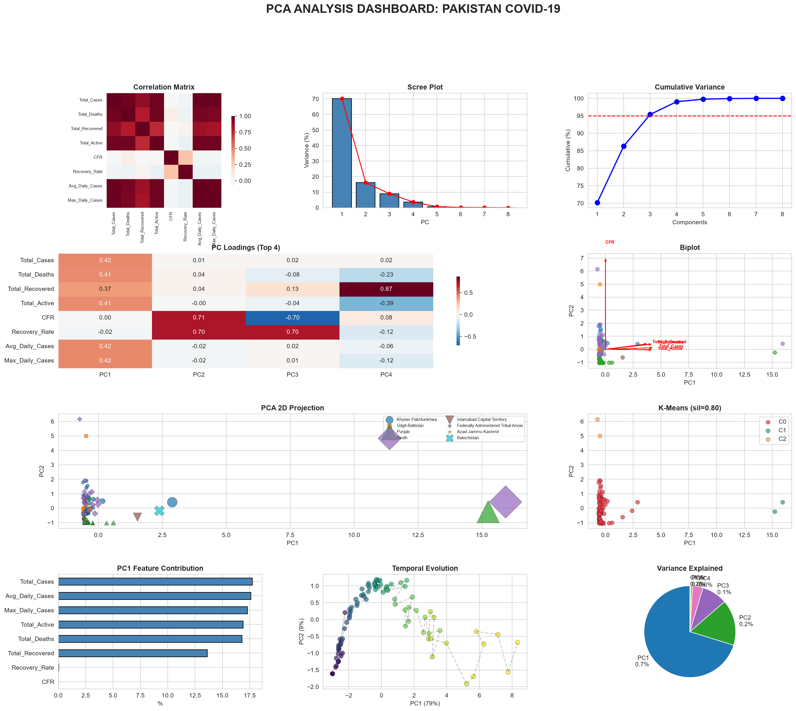

# 🦠 COVID-19 Pakistan — End-to-End Data Science Project

> **This is a historical analysis, not a live tracker.**
> Every number here describes Pakistan between **26 February and 3 June 2020**. It does not
> reflect the current COVID-19 situation in Pakistan or anywhere else, and the forecasts are
> back-tests against a closed historical window.

Exploratory analysis, statistical testing, leakage-free machine learning, ARIMA forecasting,
K-Means clustering, PCA, a Streamlit dashboard and automated reports — all built on one cleaned dataset of
Pakistan's COVID-19 records from **26 Feb 2020 to 03 Jun 2020**.

<p align="left">
  <a href="https://covid19-pakistan-analysis-n43mjecpftd2atum26wylp.streamlit.app"></a>
  
  
  
  
  
</p>

> ### 🌐 Live dashboard
> **<https://covid19-pakistan-analysis-n43mjecpftd2atum26wylp.streamlit.app>**
>
> The app reads the cleaned CSVs and the ARIMA forecast that are committed to this repo, so it
> always matches the numbers in the report. If the link does not load, the deployment needs to be
> reconnected — see [Deploying the dashboard](#deploying-the-dashboard-streamlit-community-cloud).

---

## Table of contents

- [Live dashboard](#-live-dashboard)
- [Project overview](#project-overview)
- [Key findings](#key-findings)
- [Data quality and what changed](#data-quality-and-what-changed)
- [Regression fundamentals](#regression-fundamentals)
- [Machine learning](#machine-learning)
- [ARIMA forecasting](#arima-forecasting)
- [Forecasting, clustering and PCA](#-forecasting-clustering-and-pca)
- [Project structure](#project-structure)
- [Tech stack](#tech-stack)
- [Installation](#installation)
- [Usage](#usage)
- [Limitations](#limitations)
- [Deploying the dashboard](#deploying-the-dashboard-streamlit-community-cloud)
- [Author](#author)

---

## Project overview

This project takes the raw Pakistan COVID-19 feed and carries it through a full analytical
pipeline:

| Stage | What it does |
|---|---|
| **Cleaning** | De-duplicates records, normalises 129 city spellings to 117, flags blank exposure sources |
| **EDA** | Daily / province / city / exposure-source analysis, 18 static figures, 6 interactive charts |
| **Statistics** | Descriptive profile, Pearson/Spearman correlation, chi-square, ANOVA + Tukey, four normality tests (Shapiro-Wilk, D'Agostino, Jarque-Bera, KS) and four non-parametric tests (Mann-Whitney, Kruskal-Wallis, Wilcoxon, Spearman) |
| **Regression** | Simple LR (statsmodels `sm.OLS` + scikit-learn), multiple LR with VIF, polynomial degree comparison, logistic regression, ROC/AUC/confusion matrix, KFold with Ridge and Lasso |
| **Machine learning** | 4 forecasting learners with lagged features and a chronological split |
| **Forecasting** | ARIMA with an AIC order search and a 21-day hold-out |
| **Forecasting, clustering, PCA** | One extended notebook (Holt-Winters, ARIMA/SARIMA, K-Means, hierarchical, DBSCAN, PCA, t-SNE) plus a 37-sheet Excel report with live formulas |
| **Delivery** | Streamlit dashboard, Excel workbooks, text insights report |

The whole pipeline lives in `src/` and is reproducible end to end — see [Usage](#usage).

---

## Key findings

| Metric | Value |
|---|---:|
| Date range | 26 Feb – 03 Jun 2020 |
| Cleaned records | **2,711** |
| Provinces | 8 |
| Cities (after normalisation) | **117** |
| Total cases | **83,985** |
| Total deaths | **1,728** |
| Total recovered | **24,753** |
| Case fatality rate | **2.06 %** |
| Recovery rate | **29.47 %** |
| Peak day | **4,677** cases on 03 Jun 2020 |

### Top provinces

| Rank | Province | Cases | CFR |
|:--:|---|---:|---:|
| 1 | Sindh | 32,858 | 1.66 % |
| 2 | Punjab | 31,096 | 1.91 % |
| 3 | Khyber Pakhtunkhwa | 10,259 | 4.61 % |
| 4 | Balochistan | 5,125 | 0.96 % |
| 5 | Islamabad Capital Territory | 3,523 | 1.02 % |

Sindh and Punjab together carry **76 %** of all cases.

### Top cities

| Rank | City | Province | Cases | CFR |
|:--:|---|---|---:|---:|
| 1 | Karachi | Sindh | **29,346** | 1.70 % |
| 2 | Lahore | Punjab | **28,015** | 2.08 % |
| 3 | Quetta | Balochistan | **5,109** | 0.96 % |
| 4 | Peshawar | Khyber Pakhtunkhwa | 4,923 | 5.38 % |
| 5 | Islamabad | Islamabad Capital Territory | 3,523 | 1.02 % |

Karachi and Lahore alone account for **68 %** of national cases.

### Exposure source

| Source | Cases | Share |
|---|---:|---:|
| Local – Social Contact | 58,918 | 70.15 % |
| Unknown | 22,659 | 26.98 % |
| Tableeghi Jamaat | 1,115 | 1.33 % |
| Iran / Taftan | 1,053 | 1.25 % |

> **Read "Unknown" carefully.** 36 source rows had a blank `Travel_history` and carry
> **19,200 cases (22.9 % of the total)**, concentrated in Punjab (16,520) and Balochistan
> (2,680). They are labelled `Unknown` so the category is a **reporting gap**, not a
> transmission route. The remaining ~3,459 `Unknown` cases were explicitly recorded that way.

---

## Data quality and what changed

The earlier version of this project shipped with several data problems. All of them were
fixed, and the pipeline now documents them:

| Issue | Before | After |
|---|---|---|
| Exact duplicate rows | 2 left in | removed (2,798 → 2,796) |
| City spellings | `Tor Ghar` / `Torghar` / `Tor  Ghar`, `Mirpur Khas` / `Mirpurkhas`, `Jehlum`, `Kurrum`, `Tando Alahyar` all counted separately → **125–132 "cities"** | normalised to **117 real cities** |
| Duplicate records on the analytical key | 85 groups summing different rows | collapsed by summing `Cases` / `Deaths` / `Recovered` → **2,711 rows** |
| Blank `Travel_history` | silently filled with `Unknown`, not mentioned anywhere | flagged in the data (`Unknown`) **and explained** here and in the reports |
| Missing calendar days | dropped, so the daily series skipped 8 dates | reindexed to a complete 99-day series with zeros |
| README totals | 83,986 / 1,728 / 24,754, 125 cities | 83,985 / 1,728 / 24,753, 117 cities |
| README top cities | Lahore "~15,000", 3rd "Peshawar ~4,000" | Lahore **28,015**, 3rd is **Quetta 5,109** |

The corrected totals are asserted in `src/data_pipeline.py`, so any future change to the
cleaning rules shows up immediately in the reports.

---

## Regression fundamentals

The course asks for a specific set of regression models on the daily series, with same-day
predictors (`Day_Num`, `Deaths`, `Recovered`). That is a **descriptive** exercise, and it is
kept separate from the forecasting model in the next section, which uses lagged predictors
because a forecaster cannot see today's deaths when predicting today's cases.

Everything lives in [`src/regression_analysis.py`](src/regression_analysis.py) and is
reproduced in notebook section 4.

| # | Requirement | Implementation |
|:--:|---|---|
| 1 | Simple LR, `sm.OLS` full summary | `simple_lr_statsmodels()` — prints the complete statsmodels table |
| 2 | Simple LR, scikit-learn | `simple_lr_sklearn()` — same coefficients, confirms the two libraries agree |
| 3 | Multiple LR + VIF | `multiple_lr_vif()` — `variance_inflation_factor` plus tolerance |
| 4 | Diagnostics | `regression_diagnostics()` — Durbin-Watson, Breusch-Pagan, Jarque-Bera, Shapiro-Wilk |
| 5 | Polynomial, degree comparison | `polynomial_comparison()` — degrees 1–5 on R², adjusted R², AIC, RMSE |
| 6 | Logistic regression | `logistic_high_cases()` — `sm.Logit` on `High_Cases`, with odds ratios |
| 7 | ROC, AUC, confusion matrix | `roc_auc_confusion()` — full metric set and a Youden-J threshold |
| 8 | Cross-validation, Ridge/Lasso | `cross_validation_ridge_lasso()` — KFold across an alpha grid |
| 9 | Excel export | `export_report()` → `outputs/Regression_Analysis_Report.xlsx` |

### Results

**Simple linear regression** `Cases = -615.94 + 33.45 × Day_Num`

| Metric | Value |
|---|---:|
| R² | 0.7523 |
| Adjusted R² | 0.7495 |
| F (p) | 270.4 (1.03e-28) |
| Residual std error | 504.19 |

**Multiple linear regression** `Cases = -148.90 + 30.64·Deaths + 0.231·Recovered + 9.28·Day_Num`

| Metric | Value |
|---|---:|
| R² | 0.8846 |
| Adjusted R² | 0.8806 |
| F (p) | 222.26 (1.14e-40) |
| Max VIF | 5.67 (Deaths, moderate) |

**Diagnostics** — the residuals are autocorrelated, heteroscedastic and non-normal, which is
exactly what a time series does and the reason the forecasting section uses lagged features:

| Test | Statistic | p | Reading |
|---|---:|---:|---|
| Durbin-Watson | 1.2786 | — | positive autocorrelation |
| Breusch-Pagan | 20.80 | 0.0001 | heteroscedastic |
| Jarque-Bera | 117.20 | ≈ 0 | residuals not normal |
| Shapiro-Wilk | 0.8890 | ≈ 0 | residuals not normal |

**Polynomial comparison**

| Degree | R² | Adjusted R² | AIC | RMSE |
|---:|---:|---:|---:|---:|
| 1 | 0.7523 | 0.7495 | 1394.8 | 504.2 |
| 2 | 0.8679 | 0.8649 | 1339.6 | 368.2 |
| 3 | 0.8789 | 0.8747 | 1333.7 | 352.6 |
| 4 | 0.8892 | 0.8840 | 1327.7 | 337.3 |
| 5 | 0.9115 | 0.9063 | 1309.2 | 301.4 |

Degree 5 fits best in-sample, but that is overfitting; the quadratic is the interpretable
choice and already captures the accelerate-then-flatten shape.

**Logistic regression** `logit(p) = -4.713 + 0.286·Day_Num − 0.191·Deaths`, pseudo R² = 0.694

| Metric | Value |
|---|---:|
| Accuracy | 0.9451 |
| Precision | 0.9600 |
| Recall | 0.9730 |
| F1 | 0.9664 |
| AUC | 0.9769 |

Confusion matrix: TN 14, FP 3, FN 2, TP 72. The high AUC is a property of the exercise (the
target is a threshold on a monotone curve), not a clinical result.

**Cross-validation** (5-fold KFold, standardised features): OLS 0.8495, best Ridge
(α = 0.01) 0.8495, best Lasso (α = 10) 0.8511.

### Cross-check against the Excel workbook

The same models were built independently in `PK_COVID_Analysis_FINAL.xlsx`. Both
implementations return identical coefficients — simple LR slope 33.4532, multiple LR
`-148.9037 / 30.6391 / 0.2314 / 9.2838`, logistic `-4.7128 / 0.2864 / -0.1906` — so the two
deliverables validate each other rather than being two unverified copies.

## Machine learning

> **This section was rebuilt.** The previous model predicted daily `Cases` using the
> **same row's** `Deaths` and `Recovered` and a **random** train/test split, which reported
> an R² of 0.75 that meant nothing. It also imported `GridSearchCV` without ever calling it.

### What the model does now

- **Only lagged predictors.** Every feature comes from day *t-1* or earlier: lag-1/3/7 case
  counts, lag-1 deaths and recoveries, 7- and 14-day rolling mean/std/max, cumulative cases
  and the growth rate up to *t-1*. No same-day information reaches the target.
- **Chronological split.** The final 21 days are held out, so the test window sits strictly
  after the training window.
- **Real tuning.** Random Forest and Gradient Boosting run through `GridSearchCV` with
  `TimeSeriesSplit(4)` inside the training window. Best parameters are saved to
  `models/model_metadata.json`.
- **Honest benchmark.** A naive "tomorrow = today" model is trained and scored alongside,
  because a forecast is only useful if it beats that.

### Results (21-day hold-out)

| Model | R² | RMSE | MAE | MAPE |
|---|---:|---:|---:|---:|
| **Naive (tomorrow = today)** | **0.779** | **434** | **347** | **15.3 %** |
| Gradient Boosting (tuned) | −0.264 | 1,039 | 720 | 26.3 % |
| Random Forest (tuned) | −0.358 | 1,077 | 719 | 25.0 % |
| Ridge (tuned) | −0.500 | 1,131 | 884 | 34.4 % |
| Linear Regression | −12.065 | 3,339 | 2,739 | 124 % |

**The honest conclusion:** with 62 training days on a steeply rising curve, none of the
learners beats the naive benchmark. Reporting that is more useful than quoting an inflated
R². The pipeline demonstrates correct methodology — lagged features, time-ordered
validation, real tuning and a benchmark — and it is the reason the forecasting job is left
to ARIMA rather than to a general-purpose regressor.

Feature importances (best learner) are saved to `models/feature_importance.csv`; lag-7
cases, lag-1 CFR and the 14-day rolling mean dominate.

---

## ARIMA forecasting

The daily series is rebuilt from the cleaned pipeline (99 calendar days, gap days as zero),
so the model sees an even time index.

- **Order selection:** AIC grid search over `p ∈ {0,1,2,3,7}`, `d ∈ {0,1,2}`, `q ∈ {0,1,2,3}`
- **Selected:** ARIMA(7, 2, 1)
- **Validation:** refit on the first 78 days, forecast the final 21

| Metric | ARIMA | Naive | Seasonal naive (t-7) |
|---|---:|---:|---:|
| Hold-out MAE | 644.5 | **347.2** | 860.8 |
| Hold-out RMSE | 768.6 | — | — |
| Hold-out MAPE | 32.6 % | — | — |

ARIMA does **not** beat the naive one-day-ahead model, but it does beat the seasonal naive.
The 30-day projection is therefore presented as a **scenario envelope**, not a point
prediction:

| 30-day projection | Value |
|---|---:|
| Total forecast cases | **247,996** |
| Mean per day | 8,267 |
| Peak day | 11,553 on 03 Jul 2020 |
| Minimum day | 4,842 |

Full outputs: `outputs/arima_forecast_30d.csv`, `outputs/arima_holdout.csv`,
`outputs/arima_order_grid.csv`, `outputs/arima_summary.json`.

---

## 🧠 Forecasting, clustering and PCA

One extended notebook, [`notebooks/Covid19_Forecasting_Clustering_PCA_Analysis.ipynb`](notebooks/Covid19_Forecasting_Clustering_PCA_Analysis.ipynb), runs three further analyses on the same cleaned data. A matching Excel workbook with live formulas (no pasted values) is in [`outputs/Pakistan_COVID19_Data_Analysis_Report.xlsx`](outputs/Pakistan_COVID19_Data_Analysis_Report.xlsx), 37 sheets.

| Part | What it does | Outputs |
|:--|:--|:--|
| **A. Time series forecasting** | Daily cases: decomposition, ADF / KPSS stationarity tests, ACF / PACF, 14-day hold-out, Naive / Seasonal naive / Holt-Winters / ARIMA / SARIMA (Auto-ARIMA and Prophet if installed), model comparison, 14-day forecast with confidence interval, per-province forecasts, rolling-origin cross-validation | `outputs/forecasting/` |
| **B. K-Means clustering** | Cities, provinces, weekly phases, travel history; elbow, silhouette, Davies-Bouldin and Calinski-Harabasz for choosing K; hierarchical clustering, DBSCAN, Gaussian mixtures; K-Means rebuilt from scratch to match the Excel sheets | `outputs/clustering/` |
| **C. PCA** | Bartlett / KMO / VIF checks, scree and loadings, bootstrap check of the loadings, biplot, 2D / 3D / interactive views, K-Means in PC space, temporal PCA, Kernel PCA, t-SNE, Isomap / LLE / ICA / NMF, LDA, reconstruction error, anomaly detection | `outputs/pca/` |

### Forecasting

The notebook holds out the last **14 days** and compares six methods fitted on the first 85 days. The ARIMA section above uses a **21-day** hold-out and its own order search (`src/arima_forecast.py`), so the two sections use different windows and should not be read as contradicting each other.

| Model (14-day test, Python) | MAE | RMSE | MAPE |
|:--|--:|--:|--:|
| **Holt-Winters (additive)** | 665 | **881** | 25.0% |
| Holt-Winters (multiplicative) | 670 | 896 | 24.6% |
| ARIMA(2,2,1) | 758 | 1,025 | 26.6% |
| Naive (tomorrow = today) | 824 | 1,111 | 28.9% |
| SARIMA(2,1,2)(1,0,1,7) | 875 | 1,186 | 29.1% |
| Seasonal naive | 1,048 | 1,310 | 35.5% |

Holt-Winters beats the naive forecast by about 21%; SARIMA does not, even though it has a weekly term. The Excel workbook rebuilds Holt-Winters, SES, Holt, AR/ARIMA(1,1,0) and Excel's own `FORECAST.ETS` from formulas and reaches the same conclusion (Holt-Winters RMSE 861 vs naive 1,111 on the same 14 days).

Other results from the notebook:

- **Weekly pattern:** Monday is the highest reporting day (about 1.3x its weekly average), Sunday the lowest (about 0.8x).
- **Stationarity:** the ADF test (with lag selection) does not reject a unit root even after one difference (p about 0.95), so the notebook picks d = 2. A plain Dickey-Fuller regression without lags, as in the Excel sheet, says d = 1. Treat the order of differencing as a judgement call.
- **Uncertainty:** the ARIMA 95% interval is about 5x wider on day 14 than on day 1, and only 57% of the test days fell inside it. Short-horizon error (days 1-7) is roughly a third of the error for days 8-14.
- **Forecast:** the best model projects 4,782 cases on 04 Jun rising to 8,727 on 17 Jun (about 6,700 a day against 3,374 over the last 7 observed days). On a series that was still accelerating, read this as a scenario, not a prediction.

### Clustering (K = 3, city level, cities with at least 5 cases)

| Cluster | Cities | Share of cases | Average cases per city | CFR |
|:--|--:|--:|--:|--:|
| Epicenter (Karachi, Lahore) | 2 | 68% | 28,680 | 1.9% |
| Hotspot (Peshawar, Bajaur, Mansehra, Swabi, Kohat) | 11 | 7% | 522 | 5.9% |
| Low-burden (Quetta, Islamabad, Swat, Multan, Sukkur ...) | 95 | 25% | 220 | 1.5% |

K = 2 scores best on silhouette and Davies-Bouldin (it simply splits off the two giant cities), while K = 3 gives a more useful three-way profile. The notebook reports all four metrics and states the choice. The Excel sheets (`KMeans_City`, `Elbow_Silhouette` and others) reproduce the same assignments with formulas.

### PCA (cities with at least 10 cases)

| Finding | Value |
|:--|:--|
| PC1 (outbreak size) | 70.2% of variance |
| PC2 (CFR and recovery rate) | 16.1% of variance |
| PC1 + PC2 / PC1 + PC2 + PC3 | 86.3% / 95.4% |
| Bartlett test | p < 0.001: the features are strongly correlated |
| KMO | 0.78 |

Karachi and Lahore sit far from every other city on PC1, so on raw counts K-Means in PC space isolates them in tiny clusters, and its high silhouette score reflects that rather than clean groups among the other cities. The notebook repeats the analysis with a log transform to show how much the result depends on that choice.

<p align="center">
  
  
</p>
<p align="center">
  
  
</p>

### Run it

```bash
pip install -r requirements-dev.txt
pip install statsmodels nbformat openpyxl
jupyter notebook notebooks/Covid19_Forecasting_Clustering_PCA_Analysis.ipynb
```

Run all cells from top to bottom. `pmdarima`, `prophet`, `umap-learn` and `plotly` are optional; the matching cells are skipped if they are not installed. Figures, CSVs and Excel files are written to `outputs/forecasting/`, `outputs/clustering/` and `outputs/pca/` (set `SAVE_OUTPUTS = False` in the first cell to only display).

---

## Project structure

```text
covid-19-portfolio/
│
├── app/
│   └── app.py                     # Streamlit dashboard
│
├── data/
│   ├── raw/
│   │   └── PK COVID-19-3jun.csv
│   └── processed/
│       ├── PK_COVID_19_cleaned.csv   # 2,711 cleaned records
│       ├── daily_features.csv        # 99-day daily series + lag-free features
│       ├── province_summary.csv
│       ├── city_summary.csv
│       ├── travel_summary.csv
│       └── model_table.csv           # supervised table with lagged predictors
│
├── src/
│   ├── data_pipeline.py           # cleaning, normalisation, aggregates
│   ├── statistical_tests.py       # descriptive, correlation, chi2, ANOVA, normality, non-parametric
│   ├── regression_analysis.py     # simple/multiple/polynomial/logistic LR, VIF, diagnostics, ROC, CV
│   ├── ml_models.py               # lagged features, time split, GridSearchCV
│   ├── arima_forecast.py          # order search, hold-out, 30-day forecast
│   ├── visualizations.py          # 18 static figures + 6 interactive charts
│   └── reports.py                 # Excel workbook + text insights
│
├── models/
│   ├── covid_cases_model.pkl
│   ├── model_features.pkl
│   ├── model_metadata.json        # metrics, best params, cleaning report
│   ├── feature_importance.csv
│   └── arima_model.pkl
│
├── notebooks/
│   ├── COVID_19_analysis.ipynb    # narrative walkthrough of the same pipeline
│   └── Covid19_Forecasting_Clustering_PCA_Analysis.ipynb   # forecasting + K-Means + PCA
│
├── outputs/
│   ├── figures/                   # 18 PNG charts
│   ├── interactive/               # 6 Plotly HTML charts (~10 KB each, CDN mode)
│   ├── forecasting/               # forecasting figures + Forecasting_Report.xlsx
│   ├── clustering/                # clustering figures, CSVs, Clustering_Report.xlsx, 3D HTML
│   ├── pca/                       # PCA figures, city_pca_coordinates.csv, PCA_Analysis_Report.xlsx
│   ├── Pakistan_COVID19_Data_Analysis_Report.xlsx   # 37-sheet Excel report (live formulas)
│   ├── COVID19_Analysis_Report.xlsx
│   ├── Regression_Analysis_Report.xlsx   # 9 sheets, one per requirement
│   ├── COVID19_Insights_Report.txt
│   └── arima_*.csv / .json
│
├── requirements.txt
├── .gitignore
└── README.md
```

---

## Tech stack

| Technology | Purpose |
|---|---|
| Python 3.12 (deployed) / 3.14 (local) | Core language |
| pandas / NumPy | Data wrangling and numerics |
| Matplotlib / Seaborn | Static visualisations |
| Plotly | Interactive HTML charts |
| scikit-learn | Regression learners, `GridSearchCV`, `TimeSeriesSplit`, K-Means, PCA, t-SNE |
| statsmodels | ARIMA / SARIMA, Holt-Winters, ADF and KPSS stationarity tests |
| SciPy | Statistical tests |
| Streamlit | Interactive dashboard |
| openpyxl | Excel reports (formulas, charts) |

---

## Installation

**Prerequisites:** Python 3.10 or newer and `pip`.

```bash
python -m venv venv

# Windows
venv\Scripts\activate
# macOS / Linux
source venv/bin/activate
```

**Dashboard only** (this is what Streamlit Cloud installs):

```bash
pip install -r requirements.txt
```

**Full pipeline** (adds matplotlib, seaborn, scipy and Jupyter so the notebooks and the
figure/report scripts run):

```bash
pip install -r requirements-dev.txt
```

---

## Usage

### 1. Rebuild the data

```bash
python src/data_pipeline.py
```

Writes the cleaned CSV plus every aggregate and the supervised model table.

### 2. Train the models

```bash
python src/ml_models.py
```

Runs the tuning grid, prints the hold-out comparison against the naive benchmark, and saves
the artefacts and the metadata JSON.

### 3. Fit ARIMA and build the forecast

```bash
python src/arima_forecast.py
```

### 4. Regenerate every chart

```bash
python src/visualizations.py
```

18 PNGs into `outputs/figures`, 6 interactive HTML files into `outputs/interactive`.

### 5. Rebuild the reports

The report step also writes `Regression_Analysis_Report.xlsx` and runs the full
statistical battery.

```bash
python src/reports.py
```

### 6. Launch the dashboard

```bash
streamlit run app/app.py
```

Open <http://localhost:8501>.

### 7. Run everything at once

```bash
python src/data_pipeline.py && python src/ml_models.py && \
python src/arima_forecast.py && python src/visualizations.py && python src/reports.py
```

---

## Limitations

- **The ML models do not beat the naive benchmark.** That is reported, not hidden. The
  earlier 0.75 R² came from same-day leakage and a random split.
- **ARIMA does not beat the naive one-day-ahead model** either, though it does beat the
  seasonal naive. The projection should be read as a scenario band.
- **The clustering and PCA are dominated by two cities.** Karachi and Lahore hold 68% of cases, so on raw counts the first principal component and the K-Means split mostly say "big city vs the rest". The log-transform comparison in the notebook shows how sensitive the result is to that.
- **`Recovered` is under-reported**, so the recovery rate is a lower bound.
- **`Unknown` exposure source is a reporting gap**, and its 22,659 cases inflate the
  apparent local-transmission share.
- **Exposure source and province are correlated**, so provincial CFR differences are not a
  clean measure of care quality.
- **Only 91 distinct dates over a 99-day window**, and only 62 usable training rows after
  lag construction. Any conclusion here is descriptive, not predictive at scale.
- **Active cases are an estimate,** computed as `Cases − Deaths − Recovered`. The source
  reports recoveries in batches, so **402 of the 2,711 records (14.8%)** would show a negative
  row-level active count — Recovered exceeds Cases on those rows because recoveries were
  reported on days with no new cases for that city. The figure is never clamped to zero,
  because clamping would hide the inconsistency. The national aggregate (57,504) is positive
  and usable, but it is an approximation, not a verified active-case count.
- **The historical framing matters.** Present this as a retrospective study of Feb–Jun 2020,
  not as a report on the present. The ARIMA projection covers 04 Jun – 03 Jul 2020 and has
  already been overtaken by events.
- **The dataset is a convenience sample**, not an official government feed, so totals may
  differ from Ministry of Health figures for the same dates.

---

## Deploying the dashboard (Streamlit Community Cloud)

### "The app's code is not connected to a remote GitHub repository"

That message comes from Streamlit Cloud, not from this project. It means Streamlit cannot read
the repository it was pointed at. There are only four real causes:

| Cause | Fix |
|---|---|
| **The repository is private** | Free Streamlit Cloud can only read **public** repos. Open the repo on GitHub → **Settings → General → Danger Zone → Change visibility → Make public**. |
| **Streamlit was never granted access to GitHub** | In Streamlit Cloud click your avatar → **Settings → Linked accounts** → reconnect GitHub, and when GitHub asks, choose **"All repositories"** *(or explicitly tick this repo if you use "Only select repositories")*. |
| **The app was created before the code was pushed** | Delete the broken app in Streamlit Cloud (**⋮ → Delete**) and create it again after the repo is public. |
| **Wrong branch or wrong file path** | Use `main` and `app/app.py` exactly — see the settings table below. |

The repository for this project is already public-code-ready: it contains `requirements.txt`
at the root, the dashboard at `app/app.py`, and the data and model artefacts the app reads.

The live app is expected at
**<https://covid19-pakistan-analysis-n43mjecpftd2atum26wylp.streamlit.app>**.
If that URL is dead, redeploying over the same app keeps the URL; creating a brand-new app
produces a different one, so update this README when that happens.

### Exact deployment settings

When you click **New app** in Streamlit Cloud, fill the form exactly like this:

| Field | Value |
|---|---|
| Repository | `Bilaldataorbit/covid19-pakistan-analysis` |
| Branch | `main` |
| Main file path | `app/app.py` |
| App URL | anything you like, e.g. `covid19-pakistan` |

Optional but recommended: open **Advanced settings** and set **Python version = 3.12**.

### What the app needs at runtime

The dashboard reads only files that are committed to the repo, so no database or API keys are
required:

```text
data/processed/PK_COVID_19_cleaned.csv
data/processed/daily_features.csv
data/processed/province_summary.csv
data/processed/city_summary.csv
data/processed/travel_summary.csv
models/covid_cases_model.pkl        # optional - see the note below
models/model_features.pkl
models/model_metadata.json
outputs/arima_forecast_30d.csv
outputs/arima_summary.json
```

### The app survives a model it cannot load

A pickle is tied to the library versions that wrote it. Streamlit Cloud installs whatever
`requirements.txt` allows, which may be a different scikit-learn build than the one used to
train the model. The dashboard therefore treats the trained model as **optional**:

- if the pickle loads → the "Next-day scenario" panel shows naive, 7-day average **and** the learner
- if the pickle does not load → the panel still works with the two benchmark estimates, a
  caption explains why, and every other tab (trend, geography, exposure source, distribution,
  ARIMA forecast) is unaffected

This was verified by deliberately corrupting the pickle and re-importing the app: it still
starts, still reads the metadata and still draws the ARIMA forecast.

### If the deploy build fails

| Log message | Meaning | Fix |
|---|---|---|
| `ModuleNotFoundError: streamlit` | wrong requirements file | `requirements.txt` must sit in the **repo root** |
| `FileNotFoundError: data/processed/...` | data not committed | re-add the CSV files and push |
| `InconsistentVersionWarning` on unpickle | scikit-learn mismatch | harmless, the app falls back automatically |
| `No such file: app/app.py` | wrong main file path | use `app/app.py`, not `app.py` |

### Deploy from the command line instead

```bash
git add -A
git commit -m "deploy: dashboard ready for Streamlit Cloud"
git push origin main
```

Then create the app in the Streamlit Cloud web UI with the settings table above.

## Author

**Bilal Raza**

- GitHub: [@Bilaldataorbit](https://github.com/Bilaldataorbit)
- Email: dataorbit.official@gmail.com

## License

**MIT** — see [LICENSE](LICENSE) for the full text.

```text
MIT License · Copyright (c) 2026 Bilal Raza
```

The licence covers the code and the analysis. The underlying observations remain subject to
the terms of their original source.

## Data limitations

Short version, so nobody has to hunt for it:

- **Historical window only.** 26 February – 3 June 2020. Not a live COVID-19 tracker.
- **Missing calendar dates are filled with zero** in the daily series. That is an analytical
  assumption (no record that day), not proof that no cases occurred.
- **Active cases are estimated** as `Cases − Deaths − Recovered`. 402 records (14.8%) would show
  a negative row-level value because recoveries were reported in batches; the values are left
  as computed rather than clamped so the inconsistency stays visible.
- **`Unknown` exposure source is a reporting gap** — 19,200 of its 22,659 cases come from
  36 rows whose source field was blank.
- **Forecasts are exploratory.** The ML learners do not beat the naive baseline and ARIMA does
  not beat it either; both results are reported rather than hidden.
